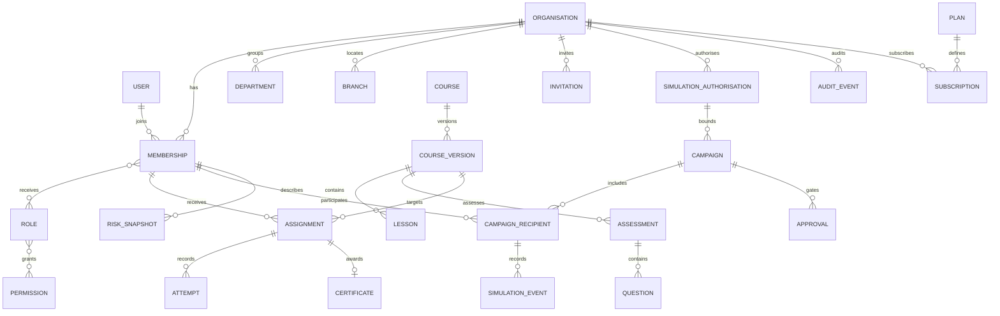

# Proposed database design

Design only; Phase 0 migrates the three stock Laravel migrations, not these domain entities.
UUID primary keys are proposed for domain entities. All tenant-owned records include
organisation_id, created_at and updated_at. Immutable evidence also records actor and version.

| Domain | Principal entities and invariants |
| --- | --- |
| Foundation | organisations(slug unique, timezone, status); users(global identity, email unique); memberships(org,user unique, status); departments; branches; membership_scopes; roles; permissions; membership_roles; role_permissions; invitations(token hash, expiry, accepted_at); audit_events(actor, action, subject, redacted metadata, correlation_id) |
| Learning | courses(owner org, source/provenance); course_versions(course, version, locale, review status, reviewer); lessons(version, position, media reference); learning_paths; path_courses; assessments(pass threshold, max attempts); questions; choices; assignments(membership, version, due_at, unique source key); lesson_progress; attempts; answers; certificates(verification ID, revoked_at); reminder_deliveries |
| Simulation | authorisations(approved actor, owned domains, validity, recipient scope, limits); templates(reviewed original content); campaigns(state, immutable scope digest, schedule); approvals(digest, distinct actor, expiry); verified_recipients; campaign_recipients(membership, unique token hash); suppressions; simulation_events(type, timestamp, dedupe key); delivery_outbox(unique campaign/recipient); remedial_rules |
| Risk | tenant-scoped immutable indicator versions (weight configuration); period aggregates are computed from timestamped learning and simulation events with effective-dated configuration and minimum-cohort suppression. No person-level risk snapshots are stored. |
| Assistant | provider_settings(secret reference, region, enabled); approved_sources; content_drafts(provenance, model version, reviewer, status); review_events; minimal usage records |
| Reporting | report_requests(scope, actor, expiry); evidence_exports(private key, checksum, expiry); certificate verification access logs without sensitive payloads |
| Integration | connections(provider, status, secret reference); sync_runs; external_identity_links(org/provider/external_id unique); scoped_api_tokens(hashed, expiry); webhook_receipts(dedupe key) |
| Commercial | plans; plan_entitlements; subscriptions(start/end/trial/status, seats, annual term); entitlement_overrides(expiry); billing_records(no card data) |

Global tables are limited to identity, permission definitions and plan catalogue. In initial
releases every course is tenant-owned; any future shared catalogue requires an explicit
read-only publication boundary with licensed original content. Role definitions are tenant-owned.

Composite foreign keys include organisation_id for every tenant association. E.g.
assignments(organisation_id,membership_id) references memberships(organisation_id,id).
membership_scopes similarly cannot refer to another tenant's branch or department. Use
ON DELETE RESTRICT for evidence parents; deletion is a governed retention workflow.
Index organisation_id with status, due_at, campaign_id and common reporting windows.
JSON metadata is allowlisted, bounded and never a place for secrets or arbitrary submitted forms.

Migrations are incremental and reversible where safe, reviewed with PostgreSQL 16 on an
isolated database. Use expand/backfill/contract for later breaking changes. Restores and
forward-fix plans precede production migrations. Do not run migrate:fresh on shared services.
